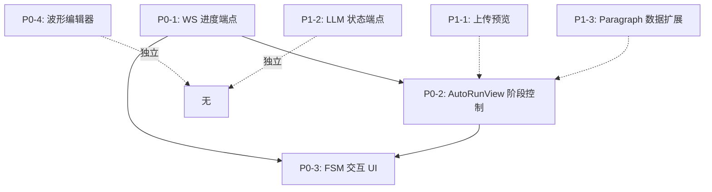

# 前端缺口实施优先级计划

基于深度研究报告（`scratch/report.md`）制定，按**阻塞程度、依赖关系、用户价值**排序。

---

## 优先级矩阵

| 优先级 | 项目 | 阻塞关系 | 预估工期 | 价值 |
|--------|------|----------|----------|------|
| **P0-1** | 流水线进度 WebSocket 端点 (`/api/ws/pipeline/{project_id}`) | 无（基础设施） | 2-3 天 | 解锁所有实时监控 |
| **P0-2** | AutoRunView 逐阶段人工干预 UI | 依赖 P0-1 | 3-4 天 | 核心工作流可用 |
| **P0-3** | FSM 交互模式控制 UI（暂停/确认/恢复/章节） | 依赖 P0-1, P0-2 | 3-4 天 | 启用人工介入流水线 |
| **P1-1** | 上传向导：提取后章节/段落预览 | 无 | 2-3 天 | 改善导入体验，减少废弃运行 |
| **P0-4** | 多轨波形编辑器（区域标注/拖拽/撤销） | 独立大模块 | 2-3 周 | 音频后处理关键能力 |
| **P1-2** | LLM Router 聚合状态端点 (`GET /api/llm/status`) | 无 | 1-2 天 | 可观测性 |
| **P1-3** | ParagraphOut 字段扩展 / ChapterTimeline 使用详情端点 | 无 | 1-2 天 | 数据完整性 |

---

## Phase 1: 核心流水线监控与控制（P0 阻塞项）

### 1.1 后端：WebSocket 流水线进度端点
**文件**：`src/audiobook_studio/api/websocket.py`（新增或扩展）
**参考**：`docs/frontend-feature-list.md` 第 310-312 行

```python
# 新增路由
@router.websocket("/ws/pipeline/{project_id}")
async def pipeline_progress_ws(websocket: WebSocket, project_id: str):
    # 复用 auto_run.py 中的进度事件广播机制
    # 发送: {stage, status, progress, current_chapter, message, timestamp}
```

**验收**：
- 前端 `usePipelineProgress.ts` 能连接并接收实时事件
- 七个阶段进度准确推送
- 断线自动重连（指数退避）

### 1.2 前端：AutoRunView 逐阶段控制面板
**文件**：`web/src/views/AutoRunView.vue`、`web/src/composables/useAutoRun.ts`

**新增 UI 元素**：
- 阶段列表（可折叠），每阶段显示：状态、进度条、当前章节、操作按钮
- 阶段操作：`暂停`、`跳过`、`重跑`、`查看中间产物`（链接到 `/auto-run/intermediate/{stage}`）
- 全局：`开始`、`暂停整体`、`取消`、`从断点恢复`

**状态机对接**：
- 后端 `auto_run.py` 已有 `PAUSED`/`RUNNING`/`COMPLETED`/`FAILED`
- 前端需映射阶段级状态：`PENDING` → `RUNNING` → `WAITING_CONFIRM` → `COMPLETED`

### 1.3 集成测试
- 启动完整 7 阶段流水线，验证前端实时反映每阶段进度
- 手动点击阶段“暂停”，验证后端收到并暂停
- 网络中断模拟，验证重连后状态同步

---

## Phase 2: FSM 交互模式前端控制 UI

### 2.1 后端确认现有端点
**文件**：`src/audiobook_studio/agent/fsm.py`、`src/audiobook_studio/api/agent_chat.py:780-940`

已有端点（需验证）：
- `POST /agent/pipeline/confirm` — 接收 `{project_id, chapter_id, action: "approve"|"reject"|"edit", edits?}`
- `GET /agent/pipeline/status/{project_id}` — 返回当前 FSM 状态、待确认章节

### 2.2 前端：AgentChatView 扩展为流水线控制台
**文件**：`web/src/views/AgentChatView.vue`、`web/src/composables/useAgentChat.ts`

**新增模式切换**：
- 左侧：章节列表（状态标签：`待标注`/`待确认`/`已通过`/`已拒绝`）
- 右侧：当前章节详情（原文/编辑文本/标注芯片/路由决策）
- 底部操作栏：`批准`、`驳回并编辑`、`请求重标注`、`跳过`

**WebSocket 事件订阅**：
- `fsm.state_changed` — 更新章节状态
- `fsm.awaiting_confirmation` — 高亮当前待确认章节，滚动定位
- `fsm.chapter_completed` — 标记完成，自动推进或停留

### 2.3 交互流程
```
用户点击"开始交互模式" → 后端进入 FSM → annotate 阶段完成 →
前端收到 awaiting_confirmation → 高亮章节 → 用户编辑/批准 →
POST /agent/pipeline/confirm → 后端继续或回滚 → 循环直到完成
```

---

## Phase 3: 上传向导章节预览（P1）

### 3.1 后端：提取结果查询端点
**文件**：`src/audiobook_studio/api/upload.py`

新增：`GET /api/upload/extraction-result/{session_id}`
返回：`{chapters: [{id, title, paragraphs: [{id, text, index}]}], stats}`

### 3.2 前端：UploadView 步骤 3 增强
**文件**：`web/src/views/UploadView.vue`、`web/src/composables/useUpload.ts`

**现状**：步骤 1 选项目 → 步骤 2 上传/提取进度 → 步骤 3 仅显示“提取完成”

**新增**：
- 步骤 3 显示章节树（可展开段落预览前 200 字）
- 每章节：`编辑`（跳转 ChapterTimeline）、`勾选/取消勾选`（决定是否纳入流水线）
- 底部：`启动流水线（选中章节）`、`返回修改`、`保存为草稿`

### 3.3 验收
- 上传 10 万字文本，提取完成后 2 秒内渲染章节树
- 勾选状态持久化到 sessionStorage，刷新不丢失
- 点击“启动流水线”正确传递选中章节 IDs 给 auto-run

---

## Phase 4: 多轨波形编辑器（P0，大型模块）

**参考**：`docs/EXECUTION_CHECKLIST.md` C-P0-2/3/4

### 4.1 技术选型
- **Waveform 渲染**：`wavesurfer.js` + `regions` 插件（成熟、支持多轨、区域拖拽）
- **状态管理**：Pinia store `useWaveformEditor.ts`（撤销栈、轨道/区域 CRUD）
- **后端对接**：`POST /api/audio/regions` 批量保存，`GET /api/audio/tracks/{chapter_id}` 获取轨道数据

### 4.2 组件拆解
```
WaveformEditor.vue (容器)
├── TrackList.vue (轨道列表：静音/独奏/锁定/重排)
├── WaveformCanvas.vue (WaveSurfer 实例挂载)
│   ├── RegionLayer.vue (区域渲染/拖拽/调整大小)
│   └── Playhead.vue (播放头同步)
├── RegionInspector.vue (选中区域：情感/语速/音高/SFX 编辑)
├── Toolbar.vue (缩放/撤销/重做/添加区域/切分/合并)
└── TimelineRuler.vue (时间刻度/标记)
```

### 4.3 里程碑
| 里程碑 | 交付物 | 预估 |
|--------|--------|------|
| M1 | 单轨波形渲染 + 播放/暂停/缩放 | 3 天 |
| M2 | 多轨切换 + 区域创建/拖拽/调整 + 撤销栈 | 5 天 |
| M3 | 区域属性编辑面板 + 批量保存 API | 3 天 |
| M4 | 键盘快捷键 + 触屏适配 + 性能优化（虚拟化长音频） | 4 天 |

---

## Phase 5: 补充端点与数据完善（P1）

### 5.1 LLM Router 聚合状态端点
**文件**：`src/audiobook_studio/api/llm.py`

```python
@router.get("/llm/status")
async def llm_status():
    return {
        "providers": await llm_client.get_provider_health(),
        "key_pools": llm_client.get_key_pool_stats(),
        "circuit_breakers": llm_client.get_circuit_breaker_states(),
        "mock_mode": settings.MOCK_LLM
    }
```

### 5.2 ParagraphOut 扩展 / ChapterTimeline 接入详情端点
**文件**：`src/audiobook_studio/schemas/__init__.py`、`web/src/types/index.ts`、`web/src/composables/useChapterTimeline.ts`

- `ParagraphOut` 新增：`tts_edit_history[]`、`quality_records[]`、`routing_decision`、`annotations_full`
- `useChapterTimeline.ts`：列表加载后，按需 `fetchParagraphDetail(id)` 填充详细字段

---

## 依赖关系图



---

## 资源分配建议

| 角色 | Phase 1 | Phase 2 | Phase 3 | Phase 4 | Phase 5 |
|------|---------|---------|---------|---------|---------|
| 后端 (1人) | 主力 | 支持 | 主力 | 支持 | 主力 |
| 前端 (1-2人) | 主力 | 主力 | 主力 | 全力 | 支持 |
| 测试 | 集成测试 | E2E 流程 | 回归 | 专项测试 | 回归 |

**并行策略**：
- Phase 1 完成后，Phase 2 和 Phase 3 可并行（不同前端组件）
- Phase 4 可提前搭建技术原型（WaveSurfer 集成），不阻塞主线
- Phase 5 穿插在任意阶段的空闲时段

---

## 验收标准汇总

| 阶段 | 关键验收指标 |
|------|--------------|
| Phase 1 | 7 阶段流水线前端实时进度 100% 准确；阶段暂停/恢复延迟 < 500ms |
| Phase 2 | FSM 交互模式下，人工确认→继续流转零报错；章节状态同步零延迟 |
| Phase 3 | 上传 10 万字文本，预览渲染 < 2s；勾选章节启动流水线成功率 100% |
| Phase 4 | 60 分钟音频波形渲染 < 3s；区域拖拽 60fps；撤销栈 50 步无内存泄漏 |
| Phase 5 | LLM 状态端点响应 < 200ms；Paragraph 详情字段前端零报错显示 |

---

## 风险与缓解

| 风险 | 影响 | 缓解措施 |
|------|------|----------|
| WaveSurfer 多轨性能不达标 | Phase 4 延期 | 提前 1 周做 PoC；备选 `tone.js` + Canvas 自绘 |
| FSM 后端状态机边缘情况未覆盖 | Phase 2 阻塞 | 要求后端补齐单测（目标 80%+ 覆盖率）后再对接 |
| WebSocket 代理/负载均衡配置问题 | Phase 1/2 部署失败 | 本地 docker-compose 模拟生产环境验证 |
| 上传大文件内存溢出 | Phase 3 稳定性 | 流式解析 + 分页加载章节树（虚拟滚动） |

---

## 起止时间建议

| 阶段 | 开始 | 结束 | 备注 |
|------|------|------|------|
| Phase 1 | Week 1 Day 1 | Week 1 Day 5 | 优先级最高，全员聚焦 |
| Phase 2 | Week 2 Day 1 | Week 2 Day 5 | 依赖 Phase 1 完成 |
| Phase 3 | Week 2 Day 1 | Week 3 Day 2 | 可与 Phase 2 并行 |
| Phase 4 | Week 1 Day 1 (原型) | Week 5 Day 5 | 长周期，早启动原型验证 |
| Phase 5 | 穿插 | Week 5 Day 5 | 利用碎片时间 |

**总工期**：~5 周（单前端 + 单后端），关键路径 ~3 周